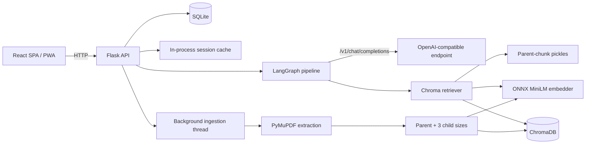
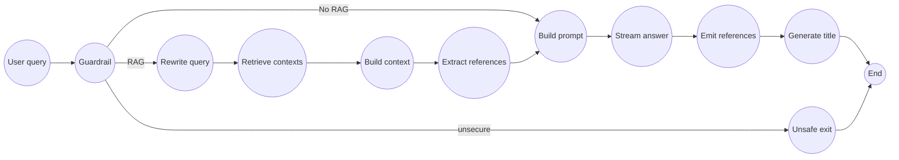

# Ognex RAG

Ognex RAG is a single-tenant document assistant. Upload PDFs and the app
extracts their text, splits it into parent and child chunks, embeds the
children locally, and stores them in Chroma. Questions are rewritten when
needed, matched against three chunk sizes with cosine similarity and MMR,
fused, and sent to an OpenAI-compatible chat model. Answers stream token by
token with separate reasoning and page-level citations; conversations and
titles are saved in SQLite.

---

## Quick start

**Prerequisites:** Python 3.11–3.13 and Node 20+.

```bash
python dev.py
```

`dev.py` is a cross-platform launcher. On first run it:

1. creates `backend/.venv` and installs Python dependencies,
2. copies `backend/.env.example` to `backend/.env` if needed,
3. installs frontend dependencies if missing,
4. starts the backend and `npm run dev` together.

Open **http://localhost:5731**.

Point `backend/.env` at your OpenAI-compatible model server:

```ini
LLM_BASE_URL=http://127.0.0.1:8000
LLM_MODEL=your-chat-model
```

### Manual start

```bash
# terminal 1 — backend
cd backend
python -m venv .venv
.venv/Scripts/activate        # Windows
# source .venv/bin/activate   # macOS / Linux
pip install -r requirements.txt
python run.py                 # http://127.0.0.1:5000

# terminal 2 — frontend
cd frontend
npm install
npm run dev                   # http://localhost:5731
```

### Install on a phone

The frontend is a PWA: it ships a web manifest, a service worker, safe-area
handling and a mobile-first layout. `npm run dev` binds to your LAN address and
the launcher prints a URL such as `http://192.168.1.20:5731`; open it on the
phone and choose **Add to Home screen**. Full PWA installation requires a
secure context, so use `localhost`, a local HTTPS proxy, or a tunnel when
testing from a phone over the network.

---

## How it works



### Query pipeline



Every node is a LangGraph node in `backend/ognex/langmodel/streamer_graph.py`.
Model access sits behind a small `ChatClient` interface, so any
OpenAI-compatible server (SGLang, vLLM, LM Studio, OpenAI) works without
touching the pipeline.

### Endpoint and model selection

Click the model name in the chat header to configure any OpenAI-compatible
endpoint, load its `/v1/models` list, and select a model. The model's
`context_length` is detected from those metadata and used for prompt budgeting.
The selection is persisted in `backend/data/runtime_settings.json`, while the
last fetched endpoint metadata is saved to `backend/endpoint_metadata.json`.
A compact bar above the composer shows the latest turn's context usage against
the detected window.

### Chat commands and context

Type `/undo` in the composer to remove the latest assistant reply and its user
query. Each assistant message stores the context it consumed (prompt tokens plus
visible answer tokens, excluding reasoning tokens) and the model's context
window, so the context meter is restored when the conversation is loaded again.

### Ingestion pipeline

1. `PyMuPDF` extracts each page and prefixes it with a provenance tag.
2. Pages are merged and split into ~2.4k-character parent chunks.
3. Each parent is split into child chunks at three sizes (500 / 250 / 150
   characters).
4. Child chunks are embedded (local ONNX MiniLM by default) and written to
   three Chroma collections; parent chunks are stored in compressed pickles.
5. Metadata (timestamp, size) is written last, which marks the knowledge base
   as ready.

---

## Configuration

Settings live in `backend/ognex/config.py` and are documented in
`backend/.env.example`.

| Variable | Default | Purpose |
|---|---|---|
| `LLM_BASE_URL` | `http://127.0.0.1:8000` | OpenAI-compatible base URL (`/v1` is appended) |
| `LLM_MODEL` | — | Default chat model id (overridable in the UI) |
| `EMBEDDING_PROVIDER` | `local` | `local` (ONNX MiniLM); `hash` fallback |
| `TOP_K_CONTEXTS` | `3` | Parent chunks passed to the model |
| `CHUNK_SIZES` | `500,250,150` | Child-chunk granularities |
| `DATA_DIR` | `backend/data` | SQLite, pickles, PDFs and Chroma persistence |

---

## Project structure

```
ognex-rag/
├── dev.py                        # one-command local launcher
├── backend/
│   ├── ognex/
│   │   ├── backend.py            # Flask app factory + routes
│   │   ├── config.py             # typed settings
│   │   ├── constants.py          # prompt builders
│   │   ├── embeddings.py         # embedder strategies + fallback
│   │   ├── cache/                # thread-safe session store
│   │   ├── database/             # SQLite repositories
│   │   ├── dataprep/             # PDF → chunks → Chroma pipeline
│   │   ├── langmodel/            # chat client, graph, timing
│   │   ├── retriever/            # Chroma client + hybrid retrieval
│   │   └── tasks/                # background ingestion runner
│   ├── endpoint_metadata.json    # last fetched model metadata
│   └── requirements.txt
├── frontend/
│   ├── public/                   # manifest, service worker, icons
│   └── src/                      # React 19 + TS + Tailwind UI
├── docs/ARCHITECTURE.md
└── docs/API.md
```

---

## Documentation

- [Architecture deep dive](docs/ARCHITECTURE.md)
- [HTTP API reference](docs/API.md)
